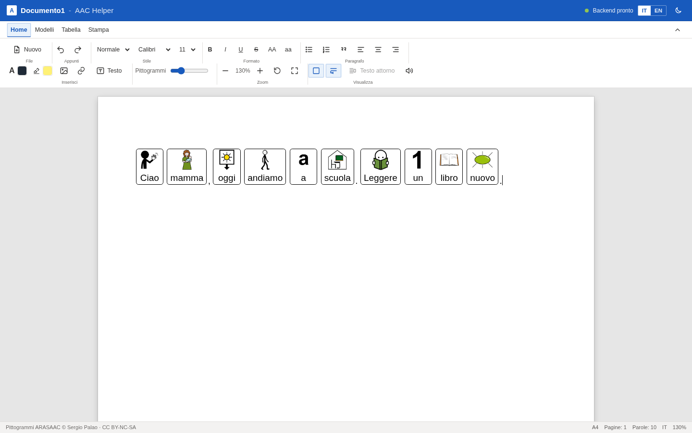
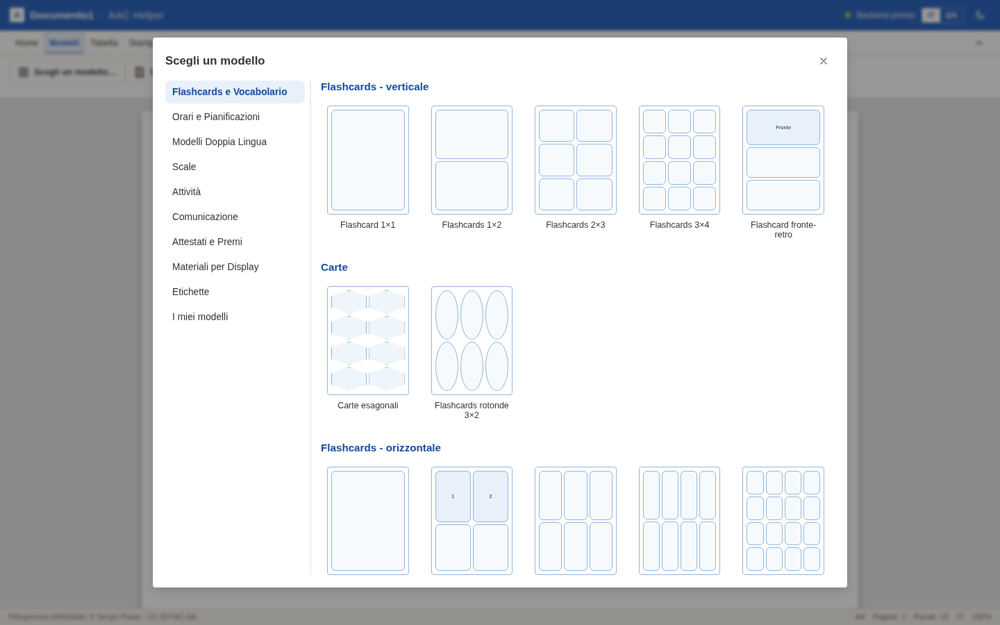
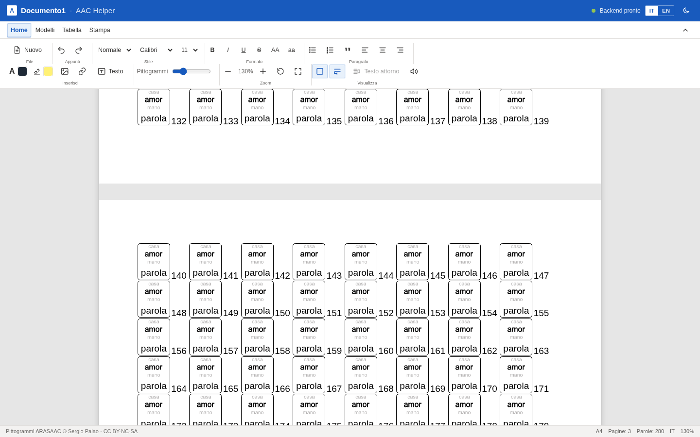
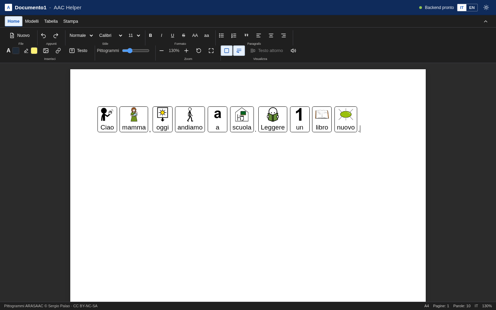
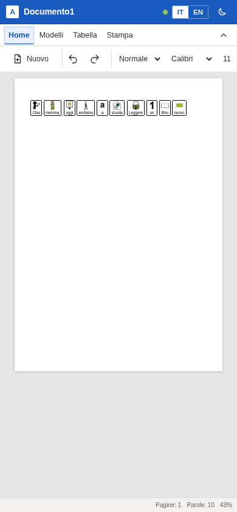

# AAC Helper

[Italiano](README.md) | **English**

A browser-based augmentative and alternative communication (AAC) editor: type a
sentence and **ARASAAC** pictograms appear automatically above the words, on an
A4 word-processor-style page.



## Features

- **Automatic pictograms** above words while typing, with manual symbol search
  and alternative pictogram selection.
- **No synonyms**: each word uses the pictogram for that word. The typed word is
  displayed, not the internal keyword.
- **Italian/English** interface and pictograms.
- ARASAAC variants: per-word size, monochrome, skin tone and hair colour.
- **A4 editor** with rich text, headings, lists, tables, free resizable images
  and text boxes.
- **Templates** for flashcards, timetables, communication boards, scales,
  activities, labels and display materials.
- **My templates** stored in the browser, with JSON export/import.
- **Autosave** in IndexedDB and restore on open.
- **Pagination** with separate sheets, margins and page count.
- **A4 print/PDF**, light/dark theme and responsive layout.

### Templates and pagination

| Templates | Pages |
| --- | --- |
|  |  |

### Dark mode and mobile

| Dark mode | Smartphone |
| --- | --- |
|  |  |

## Stack

- **Frontend:** React, TypeScript, Vite, TipTap/ProseMirror.
- **Backend:** FastAPI, spaCy, local ARASAAC index.
- **Data:** ARASAAC pictograms and keywords are downloaded locally; no ARASAAC
  data is committed to the repository.

## Quick start

Requirements: Python 3.11+, Node.js 18+.

```bash
git clone git@github.com:hellomoto8999/aac_helper.git
cd aac_helper
```

### Backend

```bash
cd backend
./setup.sh          # venv, dependencies, spaCy model and ARASAAC data
```

### Frontend and production start

```bash
cd ../frontend
npm ci
npm run build

cd ../backend
.venv/bin/uvicorn app.main:app --host 0.0.0.0 --port 5173
```

Open `http://localhost:5173`. The same service serves both the API and the built
frontend.

Development with HMR:

```bash
# terminal 1
cd backend && .venv/bin/uvicorn app.main:app --port 8000

# terminal 2
cd frontend && npm run dev
```

## Configuration

All variables are optional; see [`.env.example`](.env.example).

- `ARASAAC_LANGUAGES=it,en`
- `SPACY_MODEL=it_core_news_md`
- `CORS_ORIGINS=...`
- `OPENCODE_API_KEY=...` for the optional LLM engine
- `OPENCODE_GO_ENABLED=0` to disable it

The LLM key is never committed: it is read from
`~/.local/share/opencode/auth.json` or `OPENCODE_API_KEY`.

## API

| Method | Endpoint | Description |
| --- | --- | --- |
| GET | `/api/health` | Backend status, language, model, index |
| POST | `/api/lookup` | Words → pictograms |
| POST | `/api/convert` | Text → pictogram sequences |
| GET | `/api/search?q=&limit=` | Pictogram search |
| GET | `/api/pictogram/{id}` | Pictogram details |

## Security

- No secrets or keys are committed.
- `.env`, `opencode-auth.json`, `backend/data`, builds and dependencies are
  ignored by Git.
- The API has no authentication: use it on a local network or VPN, never expose
  it directly to the Internet.
- Pictograms are loaded from the ARASAAC CDN; text is sent to the LLM only when
  `/api/convert` is called with `use_llm=true`.

## License

- Code: **MIT** — see [`LICENSE`](LICENSE).
- Pictograms: **Sergio Palao / ARASAAC**, **CC BY-NC-SA**, non-commercial use.
  Pictograms are not included in this repository.

[Versione italiana](README.md)
