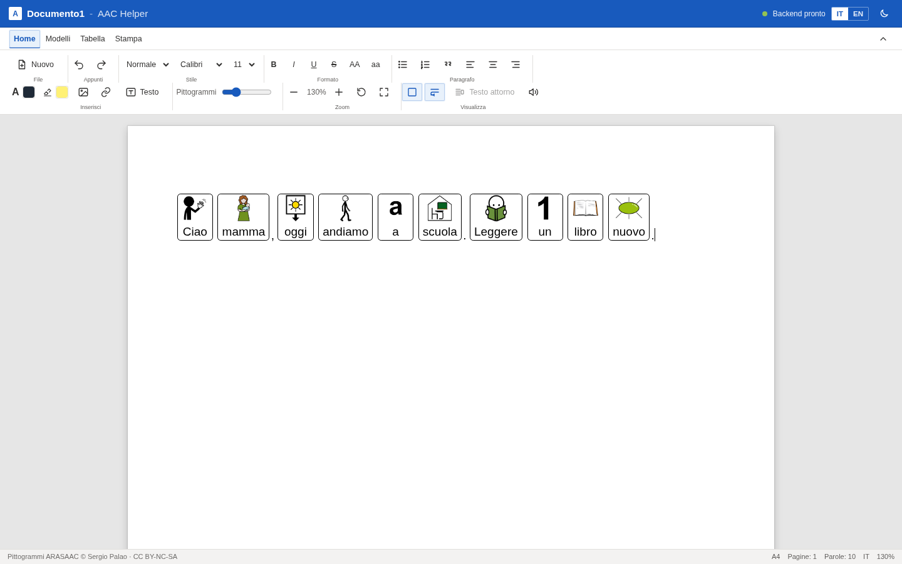
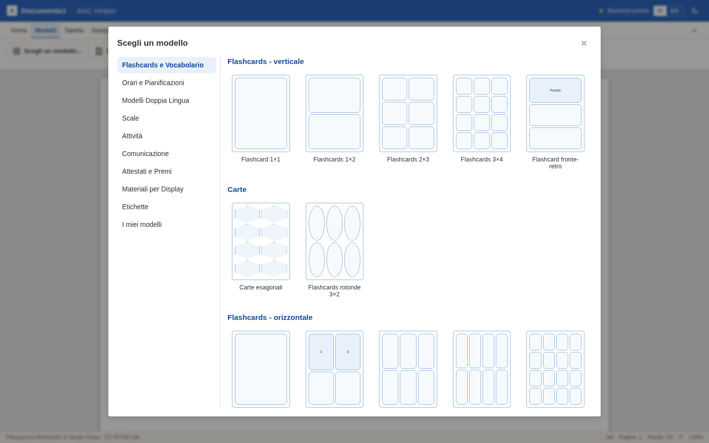
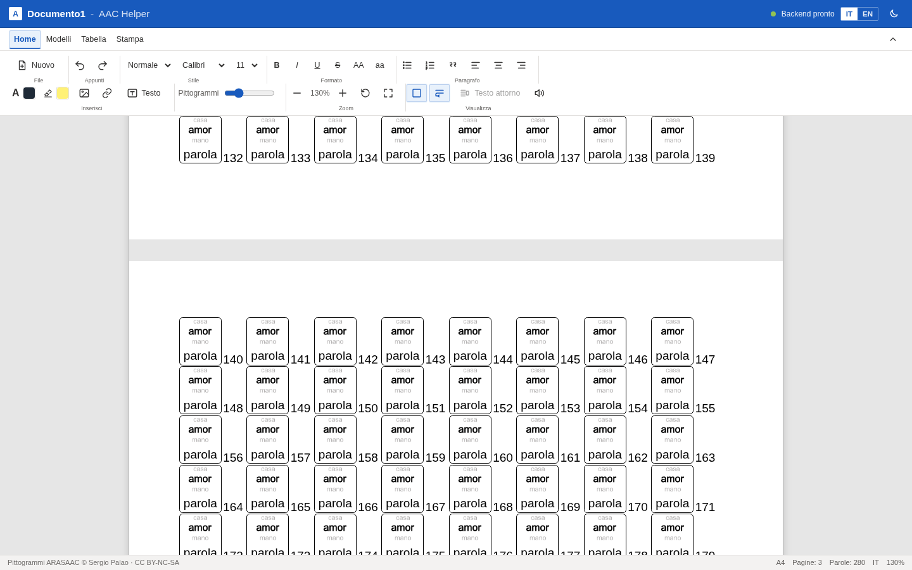
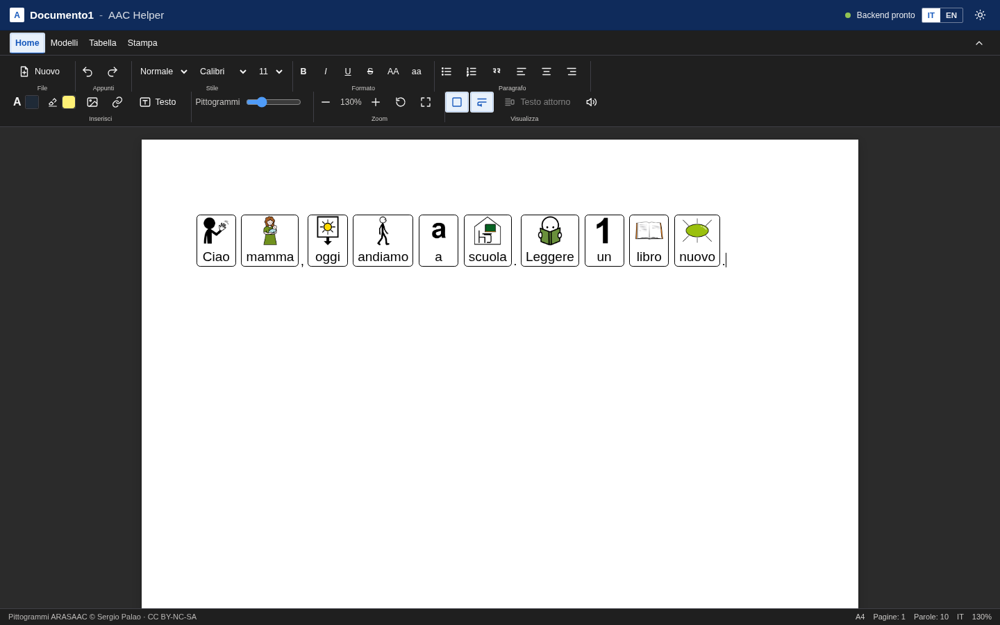
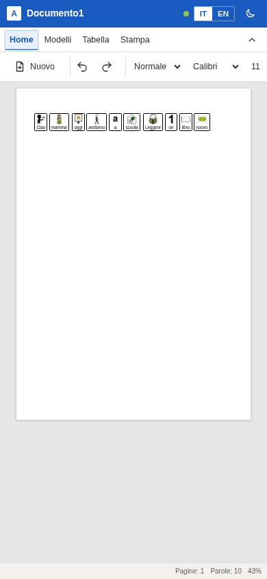

# AAC Helper

**Italiano** | [English](README.en.md)

Editor di comunicazione aumentativa e alternativa (CAA) nel browser: scrivi un
testo e i pittogrammi **ARASAAC** compaiono automaticamente sopra le parole, su
un foglio A4 in stile word processor.



## Funzionalità

- **Pittogrammi automatici** sopra le parole mentre si scrive, con ricerca
  manuale del simbolo e scelta del pittogramma alternativo.
- **Nessun sinonimo**: ogni parola usa il pittogramma della parola stessa.
  Viene mostrata la parola digitata, non la keyword interna.
- Interfaccia e pittogrammi **italiano/inglese**.
- Varianti ARASAAC: dimensione per parola, monocromatico, tonalità della pelle e
  capelli.
- **Editor A4** con formattazione, titoli, elenchi, tabelle, immagini libere
  ridimensionabili e caselle di testo.
- **Template** per flashcard, calendari, comunicazione, scale, attività,
  etichette e materiali per display.
- **I miei modelli** salvati nel browser, con esportazione/importazione JSON.
- **Autosalvataggio** del documento in IndexedDB e ripristino all'apertura.
- **Paginazione** con fogli separati, margini e conteggio pagine.
- **Stampa/PDF A4**, tema chiaro/scuro e layout responsive.

### Template e paginazione

| Modelli | Pagine |
| --- | --- |
|  |  |

### Tema scuro e mobile

| Dark mode | Smartphone |
| --- | --- |
|  |  |

## Stack

- **Frontend:** React, TypeScript, Vite, TipTap/ProseMirror.
- **Backend:** FastAPI, spaCy, indice locale ARASAAC.
- **Dati:** pittogrammi e keywords ARASAAC scaricati localmente; nessun dato
  ARASAAC è versionato.

## Avvio rapido

Requisiti: Python 3.11+, Node.js 18+.

```bash
git clone <URL-del-repository>
cd aac_helper
```

### Backend

```bash
cd backend
./setup.sh          # venv, dipendenze, modello spaCy e dati ARASAAC
```

### Frontend e avvio produzione

```bash
cd ../frontend
npm ci
npm run build

cd ../backend
.venv/bin/uvicorn app.main:app --host 0.0.0.0 --port 5173
```

Apri `http://localhost:5173`. Lo stesso servizio espone API e frontend
compilato.

Per lo sviluppo con HMR:

```bash
# terminale 1
cd backend && .venv/bin/uvicorn app.main:app --port 8000

# terminale 2
cd frontend && npm run dev
```

## Configurazione

Le variabili sono opzionali; vedi [`.env.example`](.env.example).

- `ARASAAC_LANGUAGES=it,en`
- `SPACY_MODEL=it_core_news_md`
- `CORS_ORIGINS=...`
- `OPENCODE_API_KEY=...` per il motore LLM opzionale
- `OPENCODE_GO_ENABLED=0` per disabilitarlo

La chiave LLM non è mai inclusa nel repository: viene letta da
`~/.local/share/opencode/auth.json` oppure da `OPENCODE_API_KEY`.

## API

| Metodo | Endpoint | Descrizione |
| --- | --- | --- |
| GET | `/api/health` | Stato backend, lingua, modello, indice |
| POST | `/api/lookup` | Parole → pittogrammi |
| POST | `/api/convert` | Testo → sequenze di pittogrammi |
| GET | `/api/search?q=&limit=` | Ricerca pittogrammi |
| GET | `/api/pictogram/{id}` | Dati di un pittogramma |

## Sicurezza

- Nessun segreto o chiave è versionato.
- `.env`, `opencode-auth.json`, `backend/data`, build e dipendenze sono in
  `.gitignore`.
- L'API non ha autenticazione: va usata su rete locale o VPN, non esposta
  direttamente su Internet.
- I pittogrammi sono caricati dal CDN ARASAAC; il testo può essere inviato al
  motore LLM solo se `/api/convert` viene chiamato con `use_llm=true`.

## Licenza

- Codice: **MIT** — vedi [`LICENSE`](LICENSE).
- Pittogrammi: **Sergio Palao / ARASAAC**, licenza **CC BY-NC-SA**,
  uso non commerciale. I pittogrammi non sono inclusi nel repository.

[English version](README.en.md)
